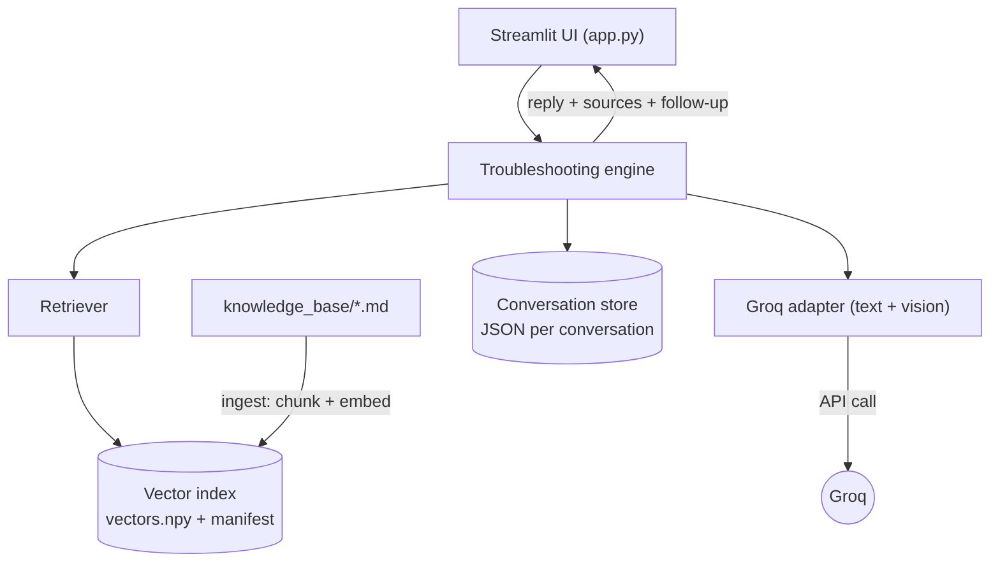
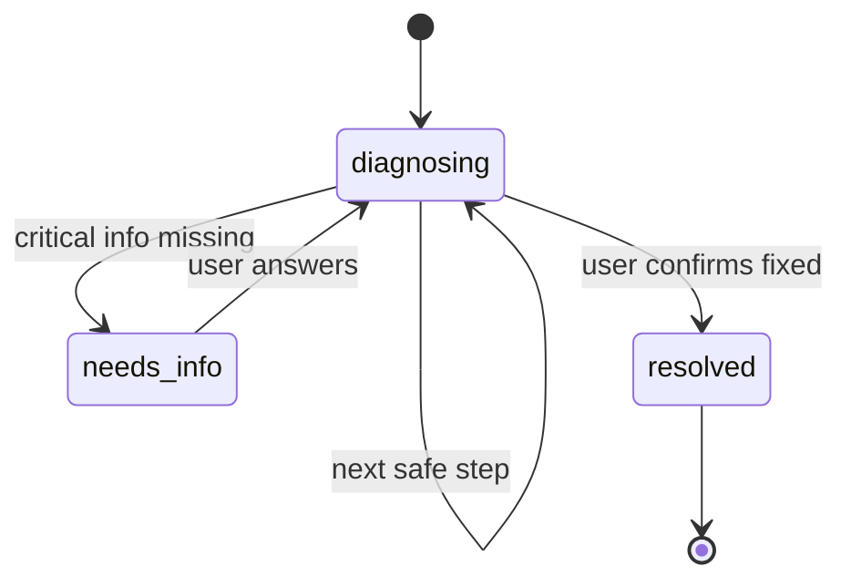

# PC-Sahayak

Windows PC troubleshooting assistant.

An AI-powered web app (Python core, React + TypeScript UI) that helps users diagnose and fix common
Windows PC problems through a step-by-step conversation. It uses the **Groq** LLM
for reasoning and **Retrieval-Augmented Generation (RAG)** over a configurable
Markdown knowledge base, so its advice is grounded in real documentation and can
cite its sources. It also accepts **screenshots** (vision model) for visual
troubleshooting.

> University project. Built **on top of the original "PC Sahayak" Streamlit +
> Groq prototype** (`github.com/Shreypatel0909/PC-Sahayak`), preserving its
> working UI and Groq integration and adding a real RAG pipeline, source
> citations, structured conversation state, and automated tests.

---

## 1. Problem statement

Generic chatbots tend to answer PC problems with a wall of unrelated steps. PC
Helper instead behaves like a patient technician: it understands the problem,
asks focused follow-up questions, and recommends **one safe action at a time**,
grounded in a documented knowledge base.

## 2. Objectives

- A clean chat interface with structured, step-by-step troubleshooting.
- An LLM backend (Groq) behind a small adapter.
- A real RAG pipeline: ingestion → chunking → embeddings → persistent vector index → retrieval.
- Multi-turn conversation with explicit, structured, persisted state.
- Follow-up questions with clickable suggested answers.
- Honest source attribution; safe, risk-aware guidance.
- Screenshot (vision) support, configurable knowledge-base path, tests, and docs.

## 3. What was improved over the prototype

| Area | Original prototype | PC-Sahayak v1.x (this project) |
|---|---|---|
| UI | Streamlit chat, category picker, suggestions, screenshot upload | **Intake form** replaces the category picker (system specs + issue + screenshot), animated replies, citations, follow-up chips, progress panel |
| LLM | Groq (text + vision) | **Kept** behind an adapter; models configurable; JSON mode for reliable structured replies |
| Grounding | None (model knowledge only) | **RAG** over a 16-file Markdown knowledge base |
| Citations | None | Sources actually retrieved/used are shown |
| State | `session_state` list | Validated `ConversationState` incl. the system profile — specs are never re-asked |
| History | Lost on refresh | **Saved locally**, listed in the sidebar, resumable (also via `?chat=<id>` in the URL), deletable |
| Config | Hard-coded | YAML + `.env`/secrets; configurable KB path |
| Tests | None | **20 pytest tests** (mocked LLM) |
| Safety | Good system prompt | Prompt + prompt-injection defence + explicit refusals |

## 4. System architecture

All-Python. Streamlit is the UI layer (the prototype's framework); the domain
logic lives in the `pc_helper` package and is framework-agnostic.



### RAG workflow


- **Ingestion** (`services/ingestion_service.py`): reads Markdown, heading-aware overlapping chunks, keeps metadata (file, heading, index).
- **Embeddings** (`services/embeddings.py`): text → vectors (see §12).
- **Vector store** (`services/vector_store.py`): persistent numpy cosine index + a manifest recording embedder, source directory, and config.
- **Retrieval** (`services/retrieval_service.py`): rewrites the message into a query using known facts/context, embeds it, returns top matches.
- **Engine** (`services/troubleshooting_service.py`): builds the prompt, calls Groq, parses a structured reply, updates state; a separate vision path for screenshots.
- **Citations**: only chunks actually retrieved **and** marked used are cited — never fabricated.

### Conversational state machine



## 5. Technologies used (and why)

| Component | Choice | Reason |
|---|---|---|
| Language | Python 3.11–3.13 | Required; all-Python project. |
| UI / app | **Streamlit** | The prototype's framework — retained per the brief; pure Python, great for a demo. |
| LLM | **Groq** (`groq` SDK) | The prototype's provider; free tier; text + vision models. |
| Embeddings | Local; `sentence-transformers` (optional) with a built-in lexical fallback | Free, offline; app runs with zero heavy deps. |
| Vector store | numpy cosine index + JSON manifest | No native builds (FAISS is awkward on Windows); transparent; adequate for a small KB; isolated behind one module. |
| Config | YAML (non-secret) + `.env`/`st.secrets` (key) | Keeps the key out of code and VCS. |
| Tests | pytest | Mocked LLM, no API credits used. |

## 6. Installation & setup

Requires Python 3.11–3.13. From the `pc-helper/` folder:

```powershell
# 1. Virtual environment
python -m venv .venv
.\.venv\Scripts\activate          # Windows PowerShell
# source .venv/bin/activate          # macOS / Linux

# 2. Install core dependencies (light, fast)
pip install -r requirements.txt

# 3. (Optional) better semantic retrieval — larger download (PyTorch)
pip install -r requirements-ml.txt

# 4. Provide your Groq API key (choose ONE):
copy .env.example .env                           # then set GROQ_API_KEY
#   or: copy .streamlit\secrets.toml.example .streamlit\secrets.toml  # then set GROQ_API_KEY
#   free key: https://console.groq.com/keys
```

## 7. Running the app

### Quick start on Windows (double-click)

Double-click **`Start PC-Sahayak.bat`** in the program folder. It checks for
everything PC-Sahayak needs and asks before installing anything that's missing:
Python 3.11–3.13, the Python packages (in a private `.venv`), Node.js (only to
build the interface once), and your Groq API key. Then it starts PC-Sahayak and
opens it in your browser. Keep its window open while you use the app; closing
the window stops it. On first run it offers to create a desktop shortcut.

**Use it from other devices on your network.** Double-click
**`Start PC-Sahayak (network).bat`** instead. After you confirm, it prints a
share link such as `http://192.168.1.20:8000/?access=ABCD2345` (also shown in
Settings with a copy button). Open that link on a phone or another PC on the
same Wi-Fi. Devices without the link are blocked; this computer never needs it.
Everyone shares the same chat history and your Groq API key, so share only on
networks you trust. If a device can't connect, set the network to *Private* in
Windows Settings › Network & internet and allow the firewall rule it offers.

To remove it, double-click **`Uninstall PC-Sahayak.bat`**. It deletes the
`.venv`, the built interface, the search index and the shortcut, then asks
separately whether to delete your saved chats, your API key, any Python or
Node.js it installed, and the program folder itself.

There are two UIs over the same Python core and the same saved chats.

### React UI (new)

The `web/` folder is a React + TypeScript app (built with Vite on Node.js). It
talks to a small FastAPI server in `api/`, which calls the unchanged `pc_helper`
engine (Groq, RAG, conversation store). Requires Node.js 18 or later.

```powershell
# one-time: install the UI's packages and build it
cd web
npm install
npm run build
cd ..

# run: the API also serves the built UI
uvicorn api.main:app --port 8000
```

Open http://localhost:8000. Each problem gets a "fix route" whose colour comes
from the problem type the assistant assigns (network, hardware, software,
startup, performance, security, general). Every step you try becomes a stop on
the route.

For UI development with hot reload, run the API and the Vite dev server in two
terminals, then open http://localhost:5173 (Vite forwards `/api` to port 8000):

```powershell
uvicorn api.main:app --reload --port 8000
cd web; npm run dev
```

### Streamlit UI (original)

```powershell
streamlit run app.py
```

Streamlit opens it in your browser (default http://localhost:8501). On first run
the app ingests the knowledge base and builds the index (reused afterwards).

### How a chat works

1. **Intake form.** Each new chat starts with a short form: device type, OS and
   version, RAM size and type, storage size and type, a description of the issue,
   and an optional screenshot. "Don't know" is always allowed, and a "Not sure
   where to find these?" section explains where Windows shows each value. The form
   is pre-filled from your last chat.
2. **Main chat.** The specs go into the structured state and every prompt, with an
   explicit rule that the assistant must not ask for them again. Your message
   slides in, a typing indicator shows while PC-Sahayak thinks, and the reply eases
   in word by word, followed by its sources and tap-to-answer suggestion chips.
3. **History.** Every chat is saved on this computer (`data/conversations/`, with
   screenshots in `data/uploads/`). The sidebar lists past chats newest-first;
   click one to resume it, or 🗑 to delete it. The URL carries `?chat=<id>`, so a
   page refresh reopens the same conversation.

## 8. Configuration

- **Secret:** `GROQ_API_KEY` in `.env` or `.streamlit/secrets.toml` (both git-ignored).
- **Everything else:** `config/config.yaml` (copy from `config/config.example.yaml`;
  if absent, the example is used). Relative paths resolve against the project root.
- **Models:** `llm.text_model` / `llm.vision_model` in the YAML (Groq model ids).
- **Pointing at a different knowledge base:** set `knowledge_base.markdown_directory`,
  then rebuild the index — sidebar **"Rebuild index"** button, or:
  ```powershell
  python -m scripts.reindex_knowledge_base
  python -m scripts.reindex_knowledge_base --kb-dir "D:\PC_Helper\knowledge_base"
  ```
  The index stores a **manifest**; if it was built from a different directory or
  embedder, the app rebuilds it rather than silently reusing a mismatched index.

## 9. Running the tests

```powershell
pip install -r requirements.txt   # includes pytest
pytest
```

Tests use a temporary knowledge base, the lightweight embedder, and a **scripted
fake LLM**, so they are fast, deterministic, and cost nothing. `tests/test_app.py`
drives the real Streamlit UI headlessly with `streamlit.testing.AppTest` (intake
form, validation, resume, chips, new chat, delete). Status: **36 passing**.

## 10. Internal module reference

The brief lists suggested REST endpoints; because the prototype (and this app)
use Streamlit rather than a separate HTTP server, those responsibilities are
implemented as service functions the UI calls directly:

| Brief endpoint | Here |
|---|---|
| `POST /api/chat` | `engine.respond(state, message, image_data_url, category)` |
| `POST /api/conversations` | `conversation_store.create()` |
| `GET /api/conversations/{id}` | `conversation_store.get(id)` |
| (history list / delete) | `conversation_store.list_conversations()` / `.delete(id)` |
| `POST /api/knowledge-base/reindex` | `ctx.reindex()` / `scripts/reindex_knowledge_base.py` |
| `GET /api/knowledge-base/status` | `ctx.index.documents` / `.chunks` / `.manifest` |
| `GET /api/health` | `ctx.llm.is_configured`, `ctx.index.chunks` |

## 11. Project structure

```text
pc-helper/
├── app.py                    # Streamlit UI (built on the prototype)
├── pc_helper/
│   ├── core/                 # config.py, context.py, logging_config.py
│   ├── models/               # chat_models.py, conversation_models.py
│   └── services/             # llm, embeddings, ingestion, vector_store,
│                             #   retrieval, conversation_store, troubleshooting
├── knowledge_base/           # 16 Markdown docs (windows/hardware/networking/software/general)
├── config/config.example.yaml
├── scripts/reindex_knowledge_base.py
├── tests/                    # pytest suite (mocked LLM)
├── data/                     # index, chat history, screenshots (runtime, git-ignored)
├── requirements.txt / requirements-ml.txt
├── .env.example / .streamlit/secrets.toml.example / .gitignore / pytest.ini
```

## 12. Embeddings: lightweight default vs. semantic upgrade

Out of the box the app uses a **built-in lexical (hashing) embedder** — zero
heavy dependencies, so it runs immediately. Its matching is keyword-based, so
retrieval quality is modest. Installing `requirements-ml.txt` enables
`sentence-transformers` (semantic embeddings); with `embeddings.backend: "auto"`
(the default) it is used automatically — just rebuild the index. **Recommended
before a graded demo.**

## 13. Safety & security

- The Groq API key is read from the environment / Streamlit secrets only, never
  hard-coded, never logged.
- Retrieved documents and user input are treated as **data, not instructions**
  (prompt-injection defence); they cannot override the system policy.
- The assistant refuses clearly destructive requests and gates risky actions
  (registry/BIOS/formatting/resets) behind warnings and backup advice.
- The app only gives instructions; it never executes commands on the user's machine.
- `.env`, `.streamlit/secrets.toml`, and `data/` are git-ignored.

## 14. Limitations

- Default lexical embedder is weaker than the optional semantic one (§12).
- The word-by-word reveal animates the finished reply; it is not token streaming
  from the model (the reply arrives as structured JSON, which can't be shown raw).
- The message animations use the CSS `:has()` selector (current Chrome, Edge,
  Firefox, Safari); older browsers simply show messages without animation.
- Single-user, local, file-backed storage — appropriate for a local university project.
- Vision quality depends on the configured Groq vision model.
- Not evaluated with real end users.

## 15. Future enhancements

- Make the semantic embedder the default once environment size allows.
- Incremental re-indexing using the per-file hashes already stored in the manifest.
- A small labelled RAG-evaluation set (retrieval hit-rate, grounding, citation accuracy).
- Streaming responses.
```
