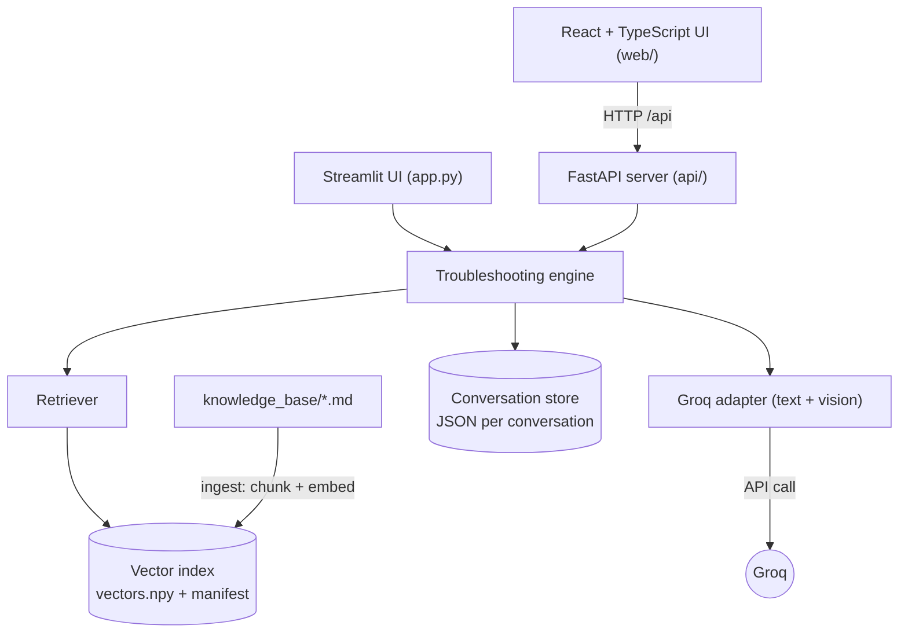
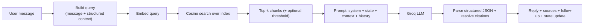
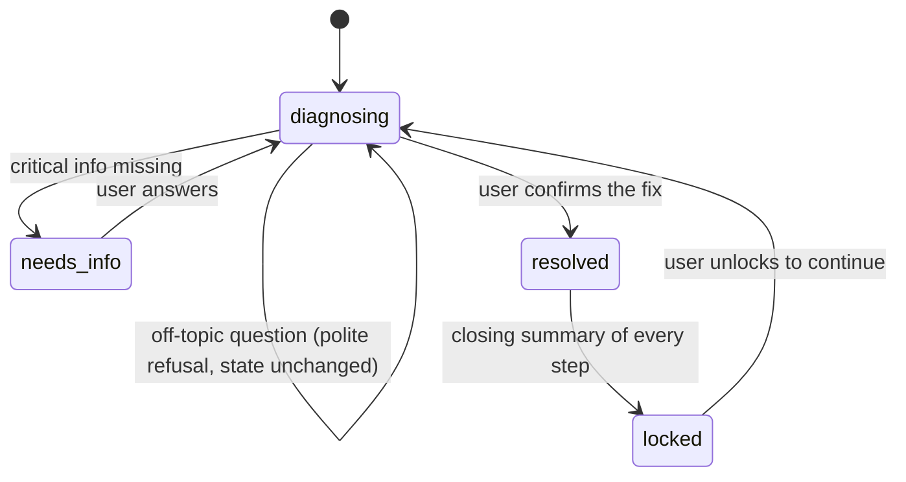

# PC-Sahayak

Windows PC troubleshooting assistant. **Version 1.3.1** (see [CHANGELOG.md](CHANGELOG.md)).

PC-Sahayak helps people diagnose and fix common Windows PC problems through a
step-by-step conversation. It uses the **Groq** LLM for reasoning and
**Retrieval-Augmented Generation (RAG)** over a Markdown knowledge base, so its
advice is grounded in real documentation and cites its sources. It also reads
**screenshots** of error messages.

- Python core (RAG, Groq, conversation state) with a **React + TypeScript**
  interface served by a small **FastAPI** server.
- One double-click to start on Windows; it checks requirements and asks before
  installing anything.
- Can be shared with phones and other PCs on your **local network** through a
  protected share link.

> University project. Built **on top of the original "PC Sahayak" Streamlit +
> Groq prototype** (`github.com/Shreypatel0909/PC-Sahayak`), keeping its Groq
> integration and adding a real RAG pipeline, source citations, structured
> conversation state, a new interface, and automated tests.

---

## Quick start (Windows)

1. Download **`PC-Sahayak-v1.3.1-windows.zip`** from the
   [Releases page](https://github.com/Shreypatel0909/PC-Sahayak/releases) and
   unzip it anywhere (or clone this repository).
2. Double-click **`Start PC-Sahayak.bat`**.
3. Answer its questions. It checks for Python 3.11–3.13 and the Python
   packages, and asks for a free Groq API key from https://console.groq.com/keys.

PC-Sahayak opens in your browser. To stop it, click the **power button** at the
top right of the app (or close the launcher window).

---

## 1. Problem statement

Generic chatbots tend to answer PC problems with a wall of unrelated steps.
PC-Sahayak instead behaves like a patient technician: it understands the
problem, asks focused follow-up questions, and recommends **one safe action at
a time**, grounded in a documented knowledge base.

## 2. Objectives

- A clear chat interface with structured, step-by-step troubleshooting.
- An LLM backend (Groq) behind a small adapter.
- A real RAG pipeline: ingestion → chunking → embeddings → persistent vector index → retrieval.
- Multi-turn conversation with explicit, structured, persisted state.
- Follow-up questions with tap-to-answer suggestions.
- Honest source attribution; safe, risk-aware guidance.
- Screenshot (vision) support, configurable knowledge base, tests, and docs.

## 3. What was improved over the prototype

| Area | Original prototype | PC-Sahayak 1.3 |
|---|---|---|
| Interface | Streamlit chat, category picker | **React + TypeScript** app: intake form for PC specs, colour-coded "fix route" of steps, step cards, caution boxes, answer chips, light/dark themes. The Streamlit UI is kept as an alternative. |
| LLM | Groq (text + vision) | **Kept** behind an adapter; JSON mode for reliable structured replies; detailed, beginner-friendly answers |
| Grounding | None (model knowledge only) | **RAG** over a 16-file Markdown knowledge base |
| Citations | None | Guides actually used are shown under each reply |
| Conversation | Free-form | Validated state: specs never re-asked, off-topic questions politely refused, a closing summary when the problem is solved (then the chat locks) |
| History | Lost on refresh | **Saved locally**, resumable by link, deletable (one or all) |
| Running it | `streamlit run` | **Double-click launcher** with requirement checks, desktop shortcut, uninstaller, power button |
| Sharing | None | **Local-network mode** with an access-code share link |
| Config | Hard-coded | YAML + `.env`; configurable knowledge-base path |
| Tests | None | **63 pytest tests** (mocked LLM) |
| Safety | Good system prompt | Prompt + prompt-injection defence + explicit refusals |

## 4. System architecture

The troubleshooting logic lives in the framework-agnostic `pc_helper` package.
Two interfaces sit on top of it and share the same saved chats: the React app
(through the FastAPI server in `api/`) and the original Streamlit app.



### RAG workflow



- **Ingestion** (`services/ingestion_service.py`): reads Markdown into heading-aware overlapping chunks, keeping metadata (file, heading, index).
- **Embeddings** (`services/embeddings.py`): text → vectors (see §12).
- **Vector store** (`services/vector_store.py`): persistent numpy cosine index plus a manifest recording the embedder, source directory and config.
- **Retrieval** (`services/retrieval_service.py`): turns the message into a query using known facts, embeds it, returns the top matches.
- **Engine** (`services/troubleshooting_service.py`): builds the prompt, calls Groq, parses the structured reply, updates state; a separate vision path for screenshots.
- **Citations**: only chunks actually retrieved **and** marked as used are cited, never fabricated.

### Conversation states



## 5. Technologies used (and why)

| Component | Choice | Reason |
|---|---|---|
| Core language | Python 3.11–3.13 | Required by the brief; RAG and Groq SDK. |
| Interface | **React 18 + TypeScript**, built with **Vite** (Node.js) | A distinctive, responsive UI with typed API calls; built once into static files. |
| HTTP API | **FastAPI** + Uvicorn | Thin layer over the Python core; also serves the built UI. |
| Original UI | Streamlit | The prototype's framework, kept as an alternative. |
| LLM | **Groq** (`groq` SDK) | The prototype's provider; free tier; text + vision models. |
| Embeddings | `sentence-transformers` (optional) with a built-in lexical fallback | Free, offline; runs with zero heavy dependencies. |
| Vector store | numpy cosine index + JSON manifest | No native builds (FAISS is awkward on Windows); transparent; enough for a small knowledge base. |
| Launcher | Windows batch + PowerShell | Double-click start, requirement checks, uninstall; uses `winget` to install Python/Node.js when asked. |
| Config | YAML (non-secret) + `.env` (API key) | Keeps the key out of code and version control. |
| Tests | pytest | Mocked LLM, no API credits used. |

## 6. Installation

**Recommended:** use the launcher (see Quick start). It creates a private
`.venv`, installs the packages, builds the interface if needed, and stores your
Groq API key in `.env`, asking before each step.

**Manual setup** (any OS), from the project folder:

```powershell
# 1. Python environment and packages
python -m venv .venv
.\.venv\Scripts\activate             # Windows PowerShell
# source .venv/bin/activate          # macOS / Linux
pip install -r requirements.txt

# 2. (Optional) better semantic retrieval; larger download (PyTorch)
pip install -r requirements-ml.txt

# 3. Groq API key (free: https://console.groq.com/keys)
copy .env.example .env               # then set GROQ_API_KEY

# 4. Build the interface once (Node.js 18 or later). Release zips already include it.
cd web
npm install
npm run build
cd ..
```

## 7. Running the app

### Windows launcher

| File | What it does |
|---|---|
| `Start PC-Sahayak.bat` | Checks requirements, then starts PC-Sahayak for this computer and opens the browser. Offers a desktop shortcut on first run. |
| `Start PC-Sahayak (network).bat` | Same, but also lets phones and other PCs on your network use it (see below). |
| `Uninstall PC-Sahayak.bat` | Removes what the launcher set up (see below). |

If PC-Sahayak is already running, the launcher opens it instead of starting a
second copy. If the running copy is from before an update, or is running for
this computer only when you asked for network mode, it offers to restart it.

### Closing PC-Sahayak

Click the **power button** at the top right of the app and confirm. The server
stops, the launcher window closes itself, and the page shows "PC-Sahayak is
closed". Your chats stay saved. Closing the launcher window or pressing
`Ctrl+C` in it also stops PC-Sahayak. Only the computer running PC-Sahayak
sees the power button; devices using the network link cannot close it.

### Using it on your local network

1. Double-click **`Start PC-Sahayak (network).bat`** and confirm sharing.
2. If Windows has your Wi-Fi set to **Public**, the launcher explains this and
   offers to set it to **Private** and allow PC-Sahayak through the firewall
   (one administrator prompt). Do this only for a network you trust, such as
   your home Wi-Fi. Without it, other devices usually cannot connect.
3. The launcher shows a share link such as
   `http://192.168.1.20:8000/?access=K4TQ9ZWM2P`. It is also in the app under
   **Settings**, with a Copy button.
4. Open the link on a phone or another PC on the same network.

Devices without the link see an "access link needed" page and cannot reach any
data. The link is remembered on each device, and stays the same between runs.
Everyone using it shares the same chat history and your Groq API key.

### Uninstalling

`Uninstall PC-Sahayak.bat` stops PC-Sahayak and removes the `.venv`, the built
interface, the search index, the desktop shortcut and the access code. It then
asks separately whether to remove your saved chats, your API key, the firewall
rule, the Private network setting, any Python or Node.js the launcher installed,
and finally the program folder itself (you must type `DELETE`).

### Manual start

```powershell
uvicorn api.main:app --port 8000                 # this computer only
```

Open http://localhost:8000. For interface development with hot reload, run the
API and the Vite dev server in two terminals, then open http://localhost:5173
(Vite forwards `/api` to port 8000):

```powershell
uvicorn api.main:app --reload --port 8000
cd web; npm run dev
```

The original Streamlit interface still works over the same core and chats:

```powershell
streamlit run app.py                             # http://localhost:8501
```

### How a chat works

1. **Describe the problem.** A short form asks for the device, Windows version,
   RAM and storage ("Don't know" is always fine, and "Not sure where to find
   these?" explains where Windows shows each value), plus the problem and an
   optional screenshot. It is pre-filled from your last problem.
2. **Step by step.** Each reply explains what PC-Sahayak understands, what the
   evidence suggests, one next step broken into detailed sub-steps, the
   expected result, and a question with tap-to-answer chips. Risky actions get
   a caution box. The guides used are listed under the reply.
3. **The fix route.** The panel on the right shows each step as a stop on a
   route, coloured by the problem type the assistant assigns (network,
   hardware, software, startup, performance, security, general). On a phone it
   becomes a strip at the top.
4. **Off-topic questions** get a short, polite refusal and leave the diagnosis
   untouched.
5. **Solved.** When you say it worked (or tap **✓ This solved it**), PC-Sahayak
   writes a summary of everything you did, why it worked and how to prevent it,
   then locks the chat. **Unlock chat** reopens it if the problem comes back.
6. **History.** Chats are saved on this computer (`data/conversations/`,
   screenshots in `data/uploads/`), listed on the left, and can be deleted one
   by one or all at once in Settings. The address bar carries `#<chat id>`, so
   a refresh or bookmark reopens the same chat.

## 8. Configuration

- **Secret:** `GROQ_API_KEY` in `.env` (or `.streamlit/secrets.toml`); both are git-ignored.
- **Everything else:** `config/config.yaml` (copy from `config/config.example.yaml`;
  if absent, the example is used). Relative paths resolve against the project root.
- **Models:** `llm.text_model` / `llm.vision_model` (Groq model ids). `llm.max_tokens`
  is 4096 because the default model spends part of it on hidden reasoning; lower
  values give short replies.
- **Different knowledge base:** set `knowledge_base.markdown_directory`, then
  rebuild the index (Settings › **Rebuild index**, or):
  ```powershell
  python -m scripts.reindex_knowledge_base
  python -m scripts.reindex_knowledge_base --kb-dir "D:\PC_Sahayak\knowledge_base"
  ```
  The index stores a **manifest**; if it was built from a different directory or
  embedder, the app rebuilds it rather than reusing a mismatched index.
- **Network mode** (set by the launcher): `PC_SAHAYAK_ACCESS_CODE` turns on the
  access check, and `PC_SAHAYAK_SHARE_URLS` lists the links shown in Settings.

## 9. Running the tests

```powershell
pip install -r requirements.txt   # includes pytest
pytest
```

Tests use a temporary knowledge base, the lightweight embedder and a **scripted
fake LLM**, so they are fast, deterministic and cost nothing. They cover the
engine, retrieval, ingestion, conversation state, the Streamlit UI
(`tests/test_app.py`, via `streamlit.testing.AppTest`) and the HTTP API
(`tests/test_api.py`: chats, screenshots, off-topic handling, solving and
locking, network access codes, closing). Status: **63 passing**.

## 10. API reference

The React interface talks to these endpoints (`api/main.py`):

| Method | Endpoint | Purpose |
|---|---|---|
| GET | `/api/meta` | Form options, models, knowledge-base info, last PC specs, version, share links (this PC only) |
| GET | `/api/conversations` | Saved chats, newest first, with problem type and step count |
| POST | `/api/conversations` | Start a chat: PC specs + problem text and/or screenshot |
| GET | `/api/conversations/{id}` | One chat with messages, route and sources |
| POST | `/api/conversations/{id}/messages` | Send a message and/or screenshot |
| POST | `/api/conversations/{id}/resolve` | Mark solved: closing summary, then lock |
| POST | `/api/conversations/{id}/unlock` | Reopen a solved chat |
| POST | `/api/conversations/{id}/retry` | Retry after an error reply |
| DELETE | `/api/conversations/{id}` / `/api/conversations` | Delete one chat / all chats |
| POST | `/api/reindex` | Rebuild the knowledge-base index |
| GET | `/api/uploads/{id}/{file}` | A saved screenshot |
| POST | `/api/shutdown` | Close PC-Sahayak (this PC only) |

## 11. Project structure

```text
PC-Sahayak/
├── Start PC-Sahayak.bat            # double-click launcher (this computer)
├── Start PC-Sahayak (network).bat  # launcher with local-network sharing
├── Uninstall PC-Sahayak.bat
├── launcher/                       # start.ps1, uninstall.ps1, icon
├── api/                            # FastAPI server: main.py, access.py, categories.py
├── web/                            # React + TypeScript interface (Vite)
│   └── src/                        # App.tsx, components/, lib/, styles.css
├── pc_helper/                      # Python core
│   ├── core/                       # config, context, logging
│   ├── models/                     # conversation state, messages
│   └── services/                   # llm, embeddings, ingestion, vector_store,
│                                   #   retrieval, conversation_store, troubleshooting
├── app.py                          # original Streamlit interface
├── knowledge_base/                 # 16 Markdown guides
├── config/config.example.yaml
├── scripts/reindex_knowledge_base.py
├── tests/                          # pytest suite (mocked LLM)
├── data/                           # index, chats, screenshots (created at runtime, git-ignored)
├── requirements.txt / requirements-ml.txt
└── CHANGELOG.md
```

## 12. Embeddings: lightweight default vs. semantic upgrade

Out of the box the app uses a **built-in lexical (hashing) embedder**: zero
heavy dependencies, so it runs immediately, but matching is keyword-based and
retrieval quality is modest. Installing `requirements-ml.txt` enables
`sentence-transformers` (semantic embeddings); with `embeddings.backend: "auto"`
(the default) it is used automatically after you rebuild the index.
**Recommended before a graded demo.**

## 13. Safety & security

- The Groq API key is read from `.env` only, never hard-coded, never logged.
- Retrieved documents and user input are treated as **data, not instructions**
  (prompt-injection defence); they cannot override the system policy.
- The assistant refuses clearly destructive requests and gates risky actions
  (registry, BIOS, formatting, resets) behind warnings and backup advice.
- It only gives instructions; it never runs commands on the user's machine.
- By default the server listens only on `127.0.0.1` (this computer).
- In network mode, other devices need the share link's access code; the cookie
  stores a hash, not the code. Closing the app and seeing share links are
  limited to the host PC. The firewall rule applies to private networks only.
- `.env`, `.streamlit/secrets.toml`, `data/` and the launcher's `.sahayak/`
  folder are git-ignored.

## 14. Troubleshooting

| Problem | Fix |
|---|---|
| A phone can't open the share link | Make sure it's on the same Wi-Fi, and that Windows has the network set to **Private** (Settings › Network & internet › Wi-Fi). Start network mode again and accept the firewall prompt. |
| "PC-Sahayak is already running" | It opens the running copy. To switch modes, use the power button, then start again. |
| Replies say no API key was found | Add `GROQ_API_KEY` to `.env` (the launcher can do it), then restart. |
| Port 8000 is busy | The launcher picks the next free port automatically and shows it. |
| Something on the page breaks | Use **Reload** on the error screen; if it repeats, close PC-Sahayak and start it again. |

## 15. Limitations

- Default lexical embedder is weaker than the optional semantic one (§12).
- Replies appear word by word after they arrive; this is not token streaming.
- One shared chat history per installation: everyone using network mode sees
  the same chats. Network mode is for trusted local networks, not the internet.
- The launcher is Windows-only; other systems use the manual steps.
- Vision quality depends on the configured Groq vision model.
- Not evaluated with real end users.

## 16. Future enhancements

- Make the semantic embedder the default once environment size allows.
- Separate chat histories per person in network mode.
- Incremental re-indexing using the per-file hashes already stored in the manifest.
- A small labelled RAG-evaluation set (retrieval hit-rate, grounding, citation accuracy).
- Streaming responses.
